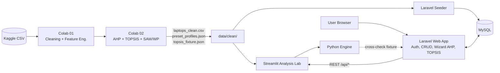
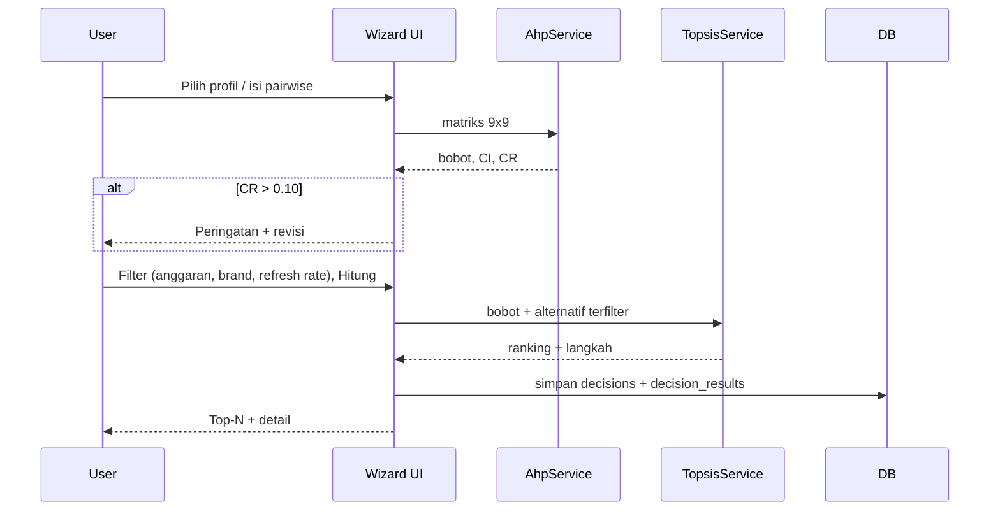

# System Architecture & Technical Specification: LapPick

**Versi:** 0.3.0 (disinkronkan dengan hasil Colab 01 dan 02)

---

## 1. Gambaran Umum Arsitektur



### Pembagian Peran
| Komponen | Peran | Alasan |
|---|---|---|
| **Laravel** | Aplikasi utama: auth, katalog, wizard AHP, hasil TOPSIS, riwayat, admin | Multi-user, CRUD, relasi DB |
| **Streamlit** | Analysis Lab: EDA, simulator bobot, sensitivitas, perbandingan metode | Visualisasi interaktif cepat |
| **Colab** | Pipeline data dan prototipe (sudah selesai) | Tanpa setup lokal, hasil reproducible |

---

## 2. Spesifikasi Stack

### 2.1 Laravel (`lappick-laravel`)
* Laravel 13, PHP 8.3.36, Blade + Tailwind CSS + Chart.js (with clean semantic SVG icons `<x-icon>`).
* Auth: Laravel Session Auth (termasuk Login Demo 1-Klik untuk UAS), role `admin` / `user`. DB: SQLite (`database/database.sqlite` siap-jalan, kompatibel MySQL).
* Engine PHP murni: `app/Services/AhpService.php`, `app/Services/TopsisService.php`.
* Lokalisasi: `lang/id/lappick.php`, `lang/en/lappick.php` dengan middleware `SetLocaleMiddleware`.
* Test: PHPUnit (`tests/Unit/McdmContractTest.php`, `tests/Feature/SpkWebRoutesTest.php`) dengan `topsis_fixture.json`.

### 2.2 Streamlit (`lab-streamlit`)
* Python 3.13 via launcher `py`.
* Paket: `streamlit` (`1.67.0`), `plotly` (`7.1.0`), `pandas`, `numpy`, `scipy`, `openpyxl`.
* Sumber data: `data/clean/laptops_clean.csv`, `preset_profiles.json`, `topsis_fixture.json`.

### 2.3 Colab
Lihat `06_COLAB_WORKFLOW_SPK_LAPTOP.md`.

---

## 3. Arsitektur Perhitungan

### 3.1 AHP (n = 9)
1. Matriks $A$ (9×9, skala Saaty 1–9, $a_{ji}=1/a_{ij}$).
2. Normalisasi kolom → rata-rata baris = bobot $w$ (dinormalisasi ulang agar $\sum w = 1$).
3. $\lambda_{max} = \frac{1}{n}\sum_i \frac{(Aw)_i}{w_i}$
4. $CI = \frac{\lambda_{max}-n}{n-1}$, $CR = \frac{CI}{RI}$, dengan **RI(9) = 1,45**.
5. RI (n=1..10): `0, 0, 0.58, 0.90, 1.12, 1.24, 1.32, 1.41, 1.45, 1.49`. Konsisten bila **CR ≤ 0,10**.

### 3.2 TOPSIS
1. $r_{ij} = x_{ij} / \sqrt{\sum_i x_{ij}^2}$
2. $y_{ij} = w_j r_{ij}$
3. $A^+_j = \max y_{ij}$ (benefit) / $\min y_{ij}$ (cost); $A^-$ kebalikannya.
4. $D_i^{\pm} = \sqrt{\sum_j (y_{ij}-A_j^{\pm})^2}$
5. $C_i = D_i^- / (D_i^+ + D_i^-)$; urut menurun, **seri diurutkan menurut `id` naik** (tie-breaker deterministik).

### 3.3 Pembanding
* **SAW:** benefit $x/\max$, cost $\min/x$, lalu $\sum w r$.
* **WP:** $S_i=\prod x_{ij}^{\pm w_j}$ (dihitung lewat log-sum), $V_i=S_i/\sum S$.
* Kesamaan peringkat: Spearman $\rho$ dan irisan Top-10.

### 3.4 Alur Request (Laravel)


---

## 4. Skema Database (Laravel)

| Tabel | Kolom Utama |
|---|---|
| `users` | id, name, email, password, role |
| `laptops` | id, brand, name, type_name, os, processor_brand, cpu_name, gpu_name, ram_type, has_ssd, expandable_memory, touchscreen, dedicated_vram_gb, screen_inches, screen_resolution, source_link, price_inr, price_idr, ram_gb, storage_gb, storage_effective_gb, cpu_ranking, gpu_benchmark, battery_hours, weight_kg, user_rating, refresh_rate_hz, is_imputed |
| `criteria` | id, code (C1..C9), name_id, name_en, type, unit, column_name, is_active |
| `profiles` | id, slug, name_id, name_en, description_id, description_en, pairwise_json, weights_json, lambda_max, ci, cr |
| `decisions` | id, user_id, profile_id (nullable), pairwise_json, weights_json, lambda_max, ci, cr, filters_json, created_at |
| `decision_results` | id, decision_id, laptop_id, d_plus, d_minus, score, rank |

Indeks: `laptops(brand)`, `laptops(price_idr)`, `laptops(type_name)`, `decision_results(decision_id, rank)`.
Seeder membaca `data/clean/laptops_clean.csv` dan `data/clean/preset_profiles.json` (bukan data ketikan manual).

---

## 5. Kontrak API Internal (untuk Streamlit)

| Endpoint | Deskripsi |
|---|---|
| `GET /api/laptops` | Daftar laptop (JSON, `?all=1`) |
| `GET /api/criteria` | Kriteria + tipe |
| `GET /api/profiles` | Preset profil + matriks pairwise + bobot |

Autentikasi: read-only publik di lingkungan lokal atau `X-API-KEY` sederhana.

---

## 6. Struktur Folder (Aktual Terwujud)
```
SPK/
├── Master_Dokumentasi_SPK_Laptop/     # 8 dokumen master (v1.0.0)
├── Laporan_UAS_SPK_LapPick.html       # Lengkap Bab 1–5 + Bab 4.5 Live Screenshots
├── README_DEMO_UAS.md                 # Panduan demo < 2 menit & tanya-jawab dosen
├── start_lappick_demo.bat             # Launcher 1-klik Laravel (8000) & Streamlit (8501)
├── assets/screenshots/                # Tangkapan layar verifikasi Light/Dark & Mobile
├── notebooks/                         # Notebook 01 & 02 + ZIP output
├── data/clean/                        # laptops_clean.csv, preset_profiles.json,
│                                      # topsis_fixture.json, cross_engine_parity_report.json
├── tools/                             # router9-mcp/, php_mcdm_eval.php, verify_cross_engine.py
├── lab-streamlit/                     # Streamlit Analysis Lab + tests/test_engine_contract.py
└── lappick-laravel/                   # Aplikasi Web Utama Laravel 13 + PHPUnit suite
```

---

## 7. Keamanan (Skala UAS)
* Validasi server-side (FormRequest): elemen matriks ∈ [1/9, 9], diagonal 1, anggaran > 0.
* CSRF, hashing password bawaan Laravel, middleware role untuk area admin.
* Tidak menyimpan data pribadi selain nama/email.
* Streamlit tidak menyimpan data pengguna.
* Kunci API/gateway AI (bila nanti dipakai) tidak boleh masuk repositori (`.env` / konfigurasi global saja).
