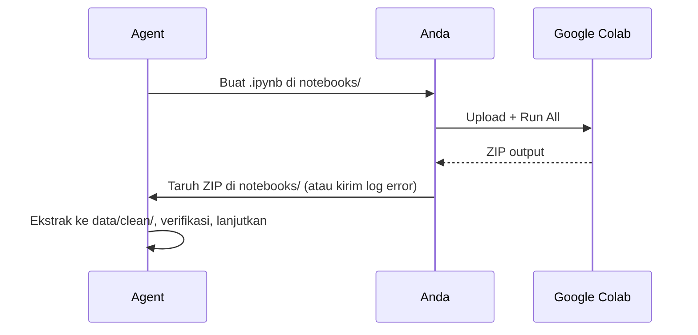

# Colab Workflow: LapPick

**Versi:** 0.3.0 — Notebook 01 dan 02 sudah dijalankan.

## 1. Status Notebook

| Notebook | Tujuan | Status | Output |
|---|---|---|---|
| `notebooks/01_data_cleaning_feature_eng.ipynb` | Unduh via `kagglehub`, decode token, cleaning, feature engineering | ✔ Selesai | `laptops_clean.csv`, `cleaning_log.json`, `data_dictionary.md` (di `lappick_colab_01_outputs.zip`) |
| `notebooks/02_mcdm_prototype_validation.ipynb` | AHP 9×9 untuk 4 preset, TOPSIS/SAW/WP, Spearman, sensitivitas | ✔ Selesai | `preset_profiles.json`, `topsis_fixture.json`, `mcdm_validation_summary.json`, `laptops_clean.csv` (di `lappick_colab_02_outputs.zip`) |
| `03_sensitivity_analysis.ipynb` | — | **Dibatalkan** (sudah tercakup di notebook 02 dan akan ada di Streamlit) | — |

Hasil ekstraksi ada di `SPK/data/clean/`. Tidak ada training ML pada proyek ini (murni MCDM).

## 2. Catatan Teknis yang Perlu Diingat
* Kolom `Refresh Rate` pada CSV asli rusak (hanya digit pertama). Notebook 01 versi awal tidak memperbaikinya; **perbaikan dilakukan terhadap `laptops_clean.csv` lewat regex** dan notebook 02 mengulang perbaikan yang sama pada saat memuat data. Karena itu **sumber kebenaran data adalah `data/clean/laptops_clean.csv`** (hasil notebook 02, 949 baris, 29 kolom).
* Notebook 01 di repositori disalin dari versi Colab yang Anda jalankan (sudah memuat perbaikan sel 5 `find_col_safe`).
* Jika notebook diubah, jalankan **Restart & Run All** dan perbarui `data/clean/`.

## 3. Mekanisme Kerja Sama

## 4. Berkas yang Dihasilkan (Kontrak)
| File | Dipakai oleh |
|---|---|
| `laptops_clean.csv` | Seeder Laravel, Streamlit |
| `preset_profiles.json` | Seeder `profiles`, Streamlit |
| `topsis_fixture.json` | Unit test PHPUnit, cross-check Streamlit |
| `mcdm_validation_summary.json` | Laporan Bab 4.4 |
| `cleaning_log.json`, `data_dictionary.md` | Laporan Bab 4.1, dokumen 05 |
