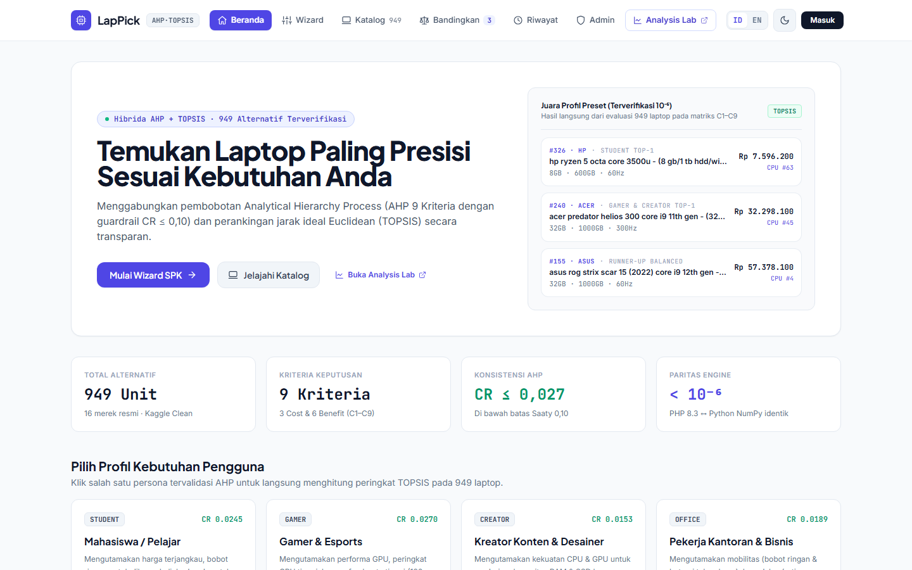
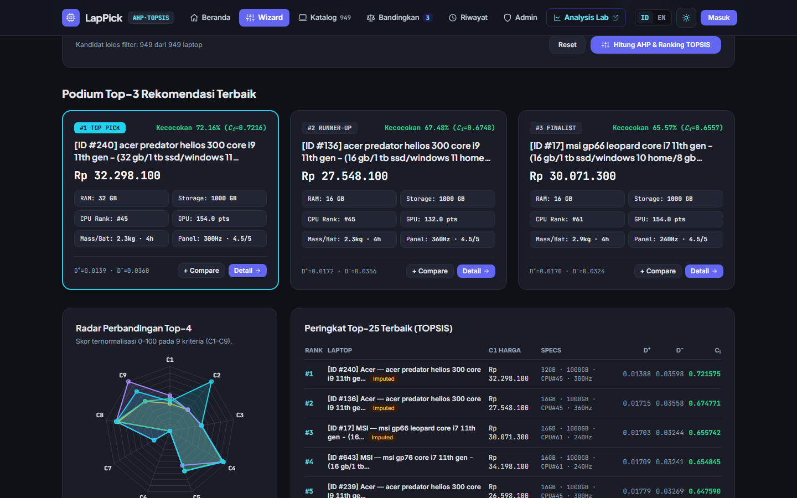
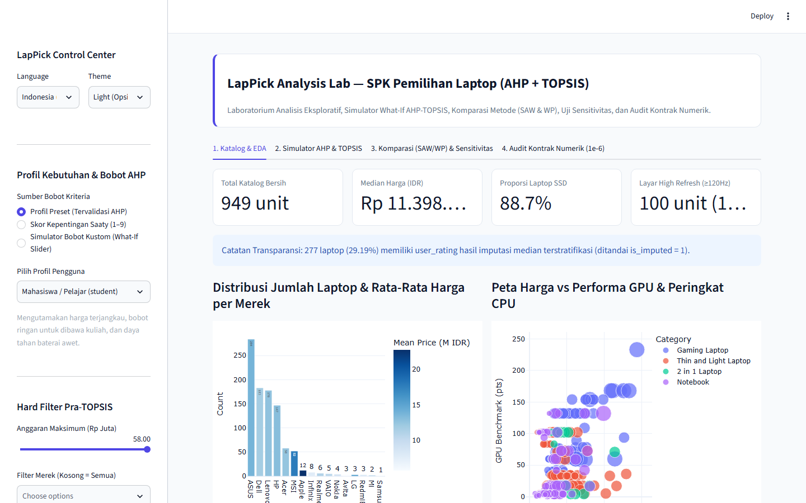

# LapPick — Hybrid AHP + TOPSIS Laptop Decision Support System



**LapPick** is a bilingual (**Indonesian / English**) Multi-Criteria Decision Making (**MCDM**) platform for recommending laptops matched to user priorities across **949 verified laptop specifications** and **9 standardized criteria (`C1`–`C9`)**.

Built as a dual-architecture system combining two independently runnable services:
- **Laravel 13 (`PHP 8.3`) Web Application** (`lappick-laravel`): AHP Weighting Wizard (4 Preset Personas, Saaty 1–9 Sliders, Custom 9×9 Pairwise Matrix with real-time `CR ≤ 0.10` guardrail), Pre-TOPSIS Hard Filters, Top-3 Podium, Chart.js 9-Dimension Radar, Step-by-Step Mathematical Matrix Transparency (`X, R, Y, A+/A-, D+/D-, Ci`), Side-by-Side Compare (2–4 laptops), Decision History (CSV/Print export), and Admin CRUD.
- **Streamlit Analysis Lab (`Python 3.10+`)** (`lab-streamlit`): Interactive EDA, Real-Time What-If Weight Simulator, Cross-Method Validation (**TOPSIS vs SAW vs WP** via Spearman $\rho$), Weight Sensitivity Stress-Tests ($\pm 10\%, \pm 20\%$), and Automated $10^{-6}$ Numerical Contract Audit.
- **Google Colab Reproducible Pipeline (`notebooks/`)**: Raw Kaggle dataset cleaning (`984 -> 949` unique laptops), forensic regex recovery of 151 truncated `refresh_rate_hz` rows, stratified median `user_rating` imputation with `is_imputed` tracking, and MCDM mathematical fixture generation.

---

## Key Verified Metrics

| Verification Area | Metric / Benchmark | Result |
|---|---|---|
| **AHP Consistency Ratio (`n = 9`, `RI = 1.45`)** | 4 Preset Personas (`student`, `gamer`, `creator`, `office`) | `CR = 0.0153 – 0.0270` (all strictly $\le 0.10$) |
| **Cross-Engine Parity (`Python NumPy` vs `PHP 8.3`)** | 4 × 949 full catalog rankings + `topsis_fixture.json` | **949/949 exact rank match** ($\max|\Delta C_i| \le 2.05 \times 10^{-15}$) |
| **Ranking Runtime Latency (949 Laptops)** | `AhpService` + `TopsisService` | **5.4 – 14.0 ms (PHP)** / **33.7 – 54.6 ms (Python)** |
| **Sensitivity Robustness (36 Scenarios)** | $\pm 10\%, \pm 20\%$ priority weight perturbation | **35 / 36 scenarios (97.2%)** preserve `#1` winner |
| **Laravel Automated Test Suite** | `McdmContractTest` + `SpkWebRoutesTest` | **5 tests, 164 assertions PASS** |

---

## User Personas & 9 Decision Criteria (`C1`–`C9`)

| Code | Criterion | Direction | Unit | Source Column |
|---|---|---|---|---|
| `C1` | Price (`1 INR = Rp 190`) | **Cost** | Rp | `price_idr` |
| `C2` | RAM Capacity | **Benefit** | GB | `ram_gb` |
| `C3` | Effective Storage (`SSD × 1.0`, `HDD × 0.6`) | **Benefit** | GB | `storage_effective_gb` |
| `C4` | CPU Ranking (`#1 = best`) | **Cost** | rank | `cpu_ranking` |
| `C5` | GPU Benchmark Score | **Benefit** | pts | `gpu_benchmark` |
| `C6` | Battery Life | **Benefit** | jam/h | `battery_hours` |
| `C7` | Weight | **Cost** | kg | `weight_kg` |
| `C8` | User Rating (`is_imputed` tracked) | **Benefit** | /5 | `user_rating` |
| `C9` | Display Refresh Rate | **Benefit** | Hz | `refresh_rate_hz` |

### Preset Champions (`data/clean/cross_engine_parity_report.json`)
- **Student (`student`, `CR = 0.0245`):** `#326 HP 245 G8` ($C_i = 0.787045$)
- **Gamer & Esports (`gamer`, `CR = 0.0270`):** `#240 Acer Predator Helios 300 300Hz RTX 3070` ($C_i = 0.721575$)
- **Content Creator (`creator`, `CR = 0.0153`):** `#240 Acer Predator Helios 300` ($C_i = 0.769117$)
- **Office & Business (`office`, `CR = 0.0189`):** `#395 HP Pavilion 13 Aero 0.97kg` ($C_i = 0.722014$)

---

## Screenshots

| Dark Mode Wizard & Radar Chart | Streamlit Analysis Lab |
|---|---|
|  |  |

---

## Quick Start (Local Installation)

> **Note:** Both services use zero external database servers (Laravel uses **SQLite**, seeded automatically from `data/clean/laptops_clean.csv`). **Node.js / npm is NOT required** — Laravel UI styling (Tailwind CSS) and charts (Chart.js) load cleanly via CDN (keep browser internet access on for styling/charts).  
> You can run **both** services together in 2 separate terminals (recommended, since the Laravel navbar links to the Analysis Lab on `:8501`), or run **either one standalone**.

### Clone Repository
```bash
git clone https://github.com/Eddienxl/LapPick.git
cd LapPick
```

---

### Terminal 1 — Laravel Web App (`http://127.0.0.1:8000`)

**Prerequisites:** **PHP `>= 8.3`** and **Composer**.  
Make sure these extensions are enabled in `php.ini` (`pdo_sqlite`, `sqlite3`, `mbstring`, `openssl`, `curl`, `fileinfo`, `zip` — already enabled out of the box in **Laragon**; if using vanilla PHP or XAMPP, uncomment them in `php.ini`).

#### Windows (PowerShell)
```powershell
cd lappick-laravel
composer install
Copy-Item .env.example .env
New-Item -ItemType File -Path database/database.sqlite -Force
php artisan key:generate
php artisan migrate --seed
php artisan serve --host=127.0.0.1 --port=8000
```

#### Linux / macOS (Bash)
```bash
cd lappick-laravel
composer install
cp .env.example .env
touch database/database.sqlite
php artisan key:generate
php artisan migrate --seed
php artisan serve --host=127.0.0.1 --port=8000
```

> `php artisan migrate --seed` automatically imports all **949 laptops**, **9 criteria (`C1–C9`)**, **4 AHP preset profiles**, and **2 demo accounts** directly from [`data/clean/`](data/clean/).  
> If you get `could not find driver`, open `php.ini` and uncomment `extension=pdo_sqlite` and `extension=sqlite3`.

#### Demo Credentials (or use 1-Click buttons on `/login`)
- **Admin:** `admin@lappick.id` / `password123`
- **Student:** `fadli@uin-suska.ac.id` / `password123`

---

### Terminal 2 — Streamlit Analysis Lab (`http://localhost:8501`)

**Prerequisites:** **Python `>= 3.10`** (`pip`).

#### Windows (PowerShell)
> Tip: On Windows, use `py` instead of `python` if the Microsoft Store stub intercepts `python`.
```powershell
cd lab-streamlit
py -m pip install -r requirements.txt
py -m streamlit run app.py --server.port 8501
```

#### Linux / macOS (Bash)
```bash
cd lab-streamlit
pip install -r requirements.txt
streamlit run app.py --server.port 8501
```

---

## Verification & Test Suites

```bash
# 1. Laravel Unit & Feature Tests (164 assertions)
cd lappick-laravel
php artisan test

# 2. Streamlit Python Engine Contract Audit
cd ..
python lab-streamlit/tests/test_engine_contract.py

# 3. Cross-Engine Parity Verification (Python NumPy <-> PHP 8.3 across 949 laptops x 4 profiles)
python tools/verify_cross_engine.py
```
*(On Windows, replace `python` with `py`, and set `$env:PHP_BIN="C:\path\to\php.exe"` if `php` is not on your global `PATH`.)*

---

## Repository Structure

```text
LapPick/
├── lappick-laravel/              # Laravel 13 web app (AhpService, TopsisService, Blade UI, Seeders, Tests)
├── lab-streamlit/                # Streamlit Analysis Lab (EDA, What-If, SAW/WP comparison, requirements.txt)
├── data/clean/                   # 949-laptop CSV, preset profiles, JSON fixtures & parity report
├── notebooks/                    # Google Colab notebooks 01 (Cleaning) & 02 (MCDM Validation)
├── tools/                        # Cross-engine parity verifier & optional 9Router MCP bridge
├── assets/screenshots/           # UI verification captures (Light/Dark, Desktop/Mobile)
├── Master_Dokumentasi_SPK_Laptop/# PRD, Design System, Architecture & Methodology specs
└── Laporan_UAS_SPK_LapPick.html  # Complete academic UAS report (Bab 1–5 + Tabel 4.12 + Gambar 4.1–4.7)
```

---

## Author & License

- **Author:** Ahmad Fadli Pratama ([`@Eddienxl`](https://github.com/Eddienxl)) — NIM. `12350111030`  
  Informatics Engineering, Faculty of Science and Technology, Universitas Islam Negeri Sultan Syarif Kasim Riau (UIN Suska Riau)
- **Software License:** [MIT License](LICENSE)
- **Dataset Attribution:** Derived from [*Laptop Ranked Specifications (2022)*](https://www.kaggle.com/datasets/dhanushbommavaram/laptop-ranked-dataset) by Dhanush Bommavaram under **CC BY-SA 4.0**.
